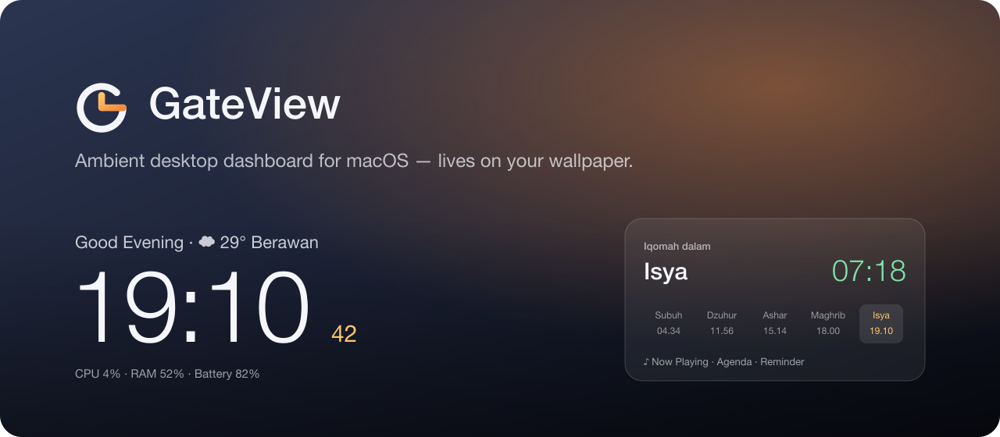

<p align="center"></p>

# GateView

An ultra-light ambient dashboard that lives **on your macOS wallpaper**: below every window, on every Space, with click-through on by default. Inspired by the Apple TV screensaver and the macOS Golden Gate wallpaper.

**~15 MB RAM · ~0% CPU idle · Universal (Apple Silicon + Intel) · macOS 13 Ventura+ · zero dependencies**

## Features

- **Clock**: big monospaced-digit clock, greeting, Indonesian date
- **Prayer times** ([Aladhan](https://aladhan.com/prayer-times-api)): countdown to adzan → iqomah → "sholat berjamaah", Friday Dzuhur becomes **Jumat**, Hijri date, cached once per day
- **Prayer reminder**: silent banner at each adzan, optional soft chime
- **Weather** ([Open-Meteo](https://open-meteo.com), no API key)
- **Now Playing**: Spotify, Music, YouTube in the browser, with artwork
- **Agenda**: next 3 events today from Apple Calendar
- **System stats**: CPU, RAM, battery
- **Real glass**: behind-window blur of your wallpaper, not a flat card
- **Customizable**: Settings window (⌘,) plus a live-reloading `~/.config/gateview/theme.json`

## Install

Download the latest `.dmg` from [Releases](../../releases), then drag GateView into Applications.

> The app is ad-hoc signed. On first launch, right-click → **Open** (or System Settings → Privacy & Security → **Open Anyway**).

## Build from source

Requires Xcode 15+ command line tools.

```bash
./build.sh      # → build/GateView.app (arm64 + x86_64)
./release.sh    # → dist/*.dmg, *.zip, SHA256SUMS.txt
```

Self-check for the prayer, weather, stats and theme logic:

```bash
swiftc GateView/Models/PrayerTimeModel.swift GateView/Services/{PrayerTimeService,WeatherService,SystemStatsService,ReminderService,ThemeStore}.swift Tests/main.swift -o /tmp/gv-check && /tmp/gv-check
```

## Customize

Use the menu bar icon → **Settings…**, or edit `~/.config/gateview/theme.json`. Any subset of keys works; missing keys keep their defaults:

```json
{
  "accent": "#7FDBFF",
  "font": "rounded",
  "clockSize": 200,
  "panelSide": "left",
  "greetingName": "Ghani",
  "city": "Jakarta",
  "latitude": -6.2,
  "longitude": 106.82,
  "iqamah": { "Maghrib": 5 }
}
```

| Key | Values |
|---|---|
| `accent` | hex color |
| `font` | `default` · `rounded` · `serif` · `monospaced` |
| `clockWeight` | `ultraLight` · `thin` · `light` · `regular` · `medium` · `bold` |
| `clockSize`, `showSeconds`, `panelSide` (`right`/`left`) | layout |
| `glassTint`, `scrim` | 0–1 darkness of the glass and of the bottom gradient |
| `showWeather`, `showAgenda`, `showNowPlaying`, `showStats` | widgets on/off |
| `city`, `country`, `prayerMethod`, `latitude`, `longitude` | location ([method ids](https://aladhan.com/calculation-methods)) |
| `iqamah` | minutes after adzan, per `Fajr`/`Dhuhr`/`Asr`/`Maghrib`/`Isha` |

## Notes

- **Now Playing** uses Apple's private MediaRemote framework. It works up to macOS 15.3; on 15.4+ the widget simply hides itself.
- GateView isn't sandboxed (MediaRemote needs that), and it is not on the Mac App Store.

## Project layout

```
GateView/
├── GateViewApp.swift        app entry, menu bar, settings window
├── WindowManager.swift      desktop-level, click-through overlay window
├── DashboardView.swift      layout + glass
├── Views/                   clock, prayer, agenda, weather, now playing, stats, settings
├── ViewModels/              DashboardViewModel
├── Services/                prayer, weather, calendar, now playing, stats, reminder, theme
└── Models/
```
